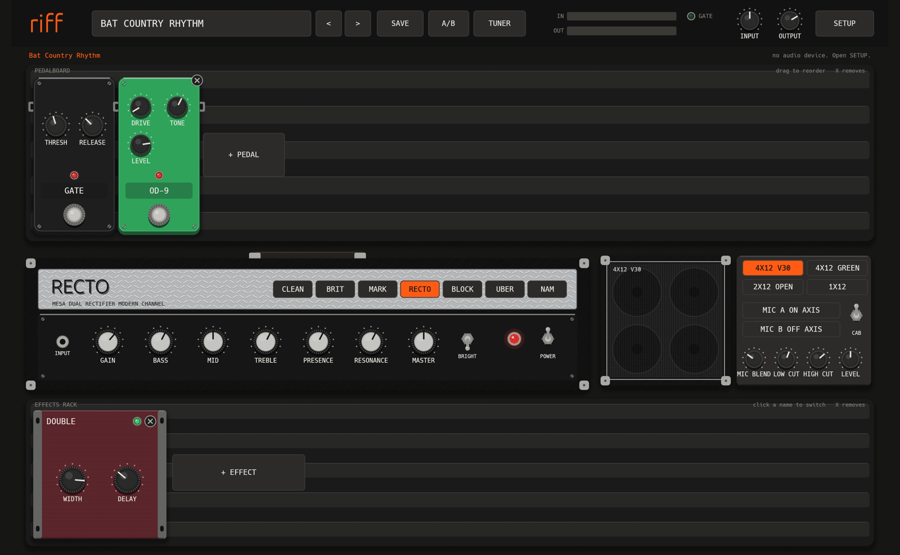

# riff

riff is a guitar amp and effects app for metal. It plays your guitar from an audio interface through pedals, an amp and a speaker cabinet. It runs as a standalone app and as a VST3 or CLAP plugin.



Read the tutorial at https://rodbove.github.io/riff/tutorial.html.

## Features

- Six amp models. The names are generic. Each model is like a famous amp:

  | Model | Like |
  | --- | --- |
  | CLEAN TWIN | Fender Twin clean |
  | BRIT 800 | Marshall JCM800 |
  | MARK IIC | Mesa Mark IIC+ lead channel |
  | RECTO | Mesa Dual Rectifier |
  | BLOCK 51 | Peavey 5150 |
  | UBER | Bogner Uberschall or Engl |

- NAM captures. Load a `.nam` file (Neural Amp Modeler) into the amp slot.
- Four cabinet models with two mics and a mic blend:
  - 4x12 V30
  - 4x12 Greenback
  - 2x12 open back
  - 1x12
- Load your own impulse responses (WAV) into each mic.
- Pedals: noise gate, boost, compressor, OD-9 (tube screamer style), RODENT (RAT style), SWEDISH (HM-2 style), wah, 10-band EQ, octave down, TUNE (pitch shift and drop tune) and ACOUSTIC (acoustic guitar simulator).
- Effects: chorus, phaser, flanger, delay (digital, analog, ping-pong), reverb (room, plate, hall), stereo doubler, post EQ, HARMONY (twin lead harmonizer) and tremolo.
- Factory presets in the style of Metallica, Dream Theater, Death, Avenged Sevenfold and Arch Enemy, plus some extras. The presets are sorted by band, then by album, then by song or part:
  - Metallica: Ride the Lightning, Master of Puppets, ...And Justice for All, Metallica (Black Album), Death Magnetic
  - Dream Theater: Train of Thought
  - Death: Symbolic
  - Avenged Sevenfold: City of Evil (with Bat Country), Avenged Sevenfold
  - Arch Enemy: Anthems of Rebellion, Rise of the Tyrant
  - Metalcore: Killswitch style (drop C), modern rhythm and ambient clean tones

  Each preset has a note with tips, for example the tuning. The presets are a start point, not exact copies.
- Save your own presets, compare two tones with A/B, and use the tuner.
- MIDI: program change selects a preset. CC 11 (expression pedal) moves the wah.

## Build and run

### macOS

1. Install Rust.
2. Run `./scripts/install.sh`. The script builds riff and copies `riff.app` to Applications.
3. Open riff from Applications.
4. Allow microphone access when macOS asks. riff needs this access to read the audio interface.

### Linux

riff uses PipeWire through its JACK layer. You do not need a JACK server. The steps are for Arch Linux. Other distributions have packages with similar names.

1. Install the build tools and the audio packages:

   ```sh
   sudo pacman -S --needed base-devel rustup pipewire pipewire-jack wireplumber rtkit realtime-privileges
   rustup default stable
   ```

2. Add your user to the `realtime` group:

   ```sh
   sudo usermod -aG realtime "$USER"
   ```

3. Log out and log in again. This step is necessary. If you do not log out, riff cannot get realtime priority and the sound crackles.
4. Run `./scripts/install.sh`. The script builds riff, copies it to `~/.local/bin` and adds riff to the app menu. To also install the VST3 and CLAP plugins, run `./scripts/install.sh --plugins`.
5. Open riff from the app menu.

In SETUP, BACKEND is PIPEWIRE / JACK. The ALSA backend is a fallback. Use it only if PipeWire does not run.

For development, run `cargo run --release -p riff-app`.

## Set up a Focusrite Scarlett Solo

1. Connect the guitar to the instrument input on the front of the Scarlett. On a 3rd gen Solo, this is input 2. On a 4th gen Solo, this is input 1.
2. Push the INST button, so that the input is in instrument mode.
3. Play hard and turn the GAIN knob on the Scarlett until the ring flashes green, not red.
4. In riff, click SETUP:
   - Set INPUT to the Scarlett.
   - Set GUITAR ON to the instrument input. riff selects it for a Scarlett Solo automatically.
   - Set OUTPUT to the Scarlett, and connect headphones or monitors to the Scarlett.
   - Set RATE to 48000 Hz and BUFFER to 128 samples.
5. Click APPLY. The status line shows the latency and the dropouts.
6. If you hear crackles, set BUFFER to 256 samples.
7. Turn off DIRECT MONITOR on the Scarlett. If you do not, you hear the clean guitar too.

### Scarlett Solo on Linux

The Linux kernel supports the Scarlett Solo (3rd and 4th gen) directly. You do not need a driver.

1. Optional: install `alsa-scarlett-gui` from the AUR. It controls INST, AIR, direct monitor and the other settings of the Scarlett. If it shows that MSD mode is on, turn MSD mode off and connect the Scarlett again.
2. Keep the default profile of the Scarlett. In this profile, each input is a separate device.
3. In riff, click SETUP:
   - Set INPUT to the instrument input of the Scarlett, for example "Scarlett Solo 4th Gen Input 1 Inst/Line". If you do not set INPUT, riff selects this input.
   - Set OUTPUT to the Scarlett or to other speakers.
   - RATE is set by PipeWire, usually 48000 Hz.
   - Set BUFFER to 128 samples. riff asks PipeWire for this buffer size. When riff closes, PipeWire uses its usual buffer size again.
4. Click APPLY. The status line shows "realtime" when the audio thread has realtime priority.

The status line also shows DSP: the part of each buffer time that riff uses. Above 50%, crackles can occur. On a CPU with fast and slow cores (for example Intel 12th gen and newer), the status line also shows P-core or E-core. FAST CORES in SETUP keeps the audio on the fast cores. It is on by default.

If you hear crackles:

- Look at the status line. If it shows NOT REALTIME, do steps 1 to 3 of the Linux installation again, then log out and log in.
- Look at DSP in the status line. If it is above 50%, set QUALITY to LITE on a NAM capture, or remove effects.
- Set the power profile to performance while you play: `powerprofilesctl set performance`. The `quiet` and `power-saver` profiles keep the CPU slow.
- Set BUFFER to 256 samples.
- Run `pw-top` in a terminal. The ERR column shows the dropouts of each program. It must stay at 0 for riff.

## Use

- Click the preset name to see the presets. Use `<` and `>`, or the left and right arrow keys, to go to the previous or next preset.
- Drag a knob up or down. Hold Shift for small changes. Double-click a knob to reset it. You can also use the mouse wheel on a knob.
- Click the footswitch of a pedal to turn the pedal on or off.
- Drag a pedal left or right to change the order. Click the X on a pedal to remove it.
- Click `+ PEDAL` or `+ EFFECT` to add one.
- Click the name of an effect in the rack to turn it on or off. Click the X to remove it.
- In the presets, select a band, then an album, then a song.
- TUNE is off in presets for songs in a lower tuning. Turn it on to play these songs with a guitar in E standard. Pitch shifting changes the tone a little. For the best sound, tune the guitar down.
- HARMONY plays a second guitar line at a fixed interval. Set INTERVAL to fit the key of the solo.
- Push T, or click TUNER, to tune. The tuner mutes the output.
- Click SAVE to save the tone as a user preset. User presets go to `~/Music/riff/presets`. On Linux, riff uses the music folder of your desktop, for example `~/Música/riff/presets`.
- Click A/B one time to store the current tone as A. Change the tone, then click A/B to switch between the two tones.

## Studio

Click STUDIO to open the multitrack recorder. Click STUDIO again to go back to the amp.

Each take keeps two signals: the dry guitar (DI) and the sound of riff. You can change the tone of a track after you record it.

To record:

1. Click REC on a track header to arm the track.
2. Click in the timeline to put the playhead where the take starts.
3. Click the red REC button, or push R. The other tracks play while you record.
4. Click REC again, or push Space, to stop.

To edit:

- Click a clip to select it. Drag the clip to move it.
- Drag the left or right edge of a clip to trim it.
- Click SPLIT, or push S, to cut the selected clip at the playhead.
- Click DELETE, or push Delete, to remove the selected clip.
- Click UNDO, or push Ctrl+Z, to undo the last edit.
- Use M to mute a track and S to solo a track. Drag the VOL bar to set the track volume. Double-click the bar to reset it.
- Use the mouse wheel to scroll the timeline. Hold Ctrl and use the mouse wheel, or click `-` and `+`, to zoom.
- Click the ruler to move the playhead. Push Home to go to the start.

Other functions:

- IMPORT puts a WAV file on the armed track at the playhead, for example a backing track or a render from another app.
- REAMP TRACK plays the DI of the armed track through the current tone and replaces the sound of the track.
- EXPORT MIX saves all tracks as one stereo WAV file.
- EXPORT DI saves the dry guitar of the armed track as a mono WAV file. Use this file to reamp in other software.

To compare riff with another amp sim and tune the tone, read [docs/tone-matching.md](docs/tone-matching.md).

riff saves the session in `~/Music/riff/studio` when you close the studio or riff. riff moves each take earlier by the measured latency, so the take lines up with the other tracks.

## NAM captures and impulse responses

riff does not include captures or IRs. You can download free ones:

- NAM captures: [ToneHunt](https://tonehunt.org). Search for 5150, Rectifier, Mark IIC+ or JCM800. Put the files in `~/Music/riff/nam`.
- Cabinet IRs: put WAV files in `~/Music/riff/ir`.

To use a capture:

1. Click NAM on the amp. Select the `.nam` file.
2. Use INPUT to set the drive into the capture, and OUTPUT to set the level.
3. If the capture includes a cabinet, turn the CAB off.
4. QUALITY selects the model in an A2 capture. FULL is the best sound. LITE uses approximately 3 times less CPU. The knob shows only for A2 captures.
5. Most captures are made at 48 kHz. Set RATE to 48000 Hz in SETUP. riff shows a warning if the rates are different.

Right-click NAM to select a different file. Click an amp model to go back to the built-in amps.

## Plugin

1. Run `cargo xtask bundle riff-plugin --release`.
2. Copy the bundles:
   - `target/bundled/riff.vst3` to `~/Library/Audio/Plug-Ins/VST3/`
   - `target/bundled/riff.clap` to `~/Library/Audio/Plug-Ins/CLAP/`
3. Open your DAW and rescan the plugins.

The plugin has the same screen as the app. The host can automate these parameters: Input, Output, Gate, Amp Gain, Wah, Delay Mix and Reverb Mix.

The plugin has no AU format. Logic Pro and GarageBand cannot load it. Use Reaper, Ableton Live, Bitwig, Studio One or another VST3 or CLAP host.

## Tests

Run `cargo test` and `cargo clippy --workspace --all-targets -- -D warnings`.

To measure the CPU use of each factory preset, run `cargo run --release -p riff-dsp --example bench`.

To measure the CPU use of a NAM capture, run `cargo run --release -p riff-dsp --example nam -- <file.nam>`. Read [docs/nam-performance.md](docs/nam-performance.md).

## License notes

The plugin uses nih-plug. The VST3 export of nih-plug is under the GPLv3.
